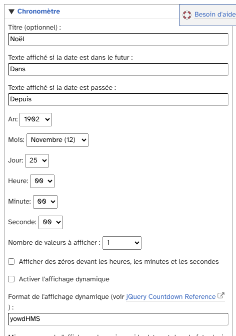
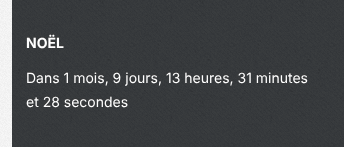
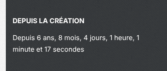
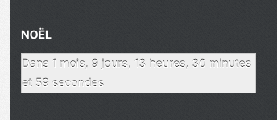

# CountDown : guide d'utilisation

Ce guide explique comment afficher sur votre blog un compte à rebours ou un chronomètre avec le widget _CountDown_.

Ce plugin n'a pas de page d'administration. Il ajoute seulement un widget.

## Sommaire

* [À quoi sert le plugin](#à-quoi-sert-le-plugin)
* [Ajouter le widget](#ajouter-le-widget)
* [Régler la date](#régler-la-date)
* [Régler les textes et l'affichage](#régler-les-textes-et-laffichage)
* [Affichage fixe ou dynamique](#affichage-fixe-ou-dynamique)
* [Régler le format dynamique](#régler-le-format-dynamique)
* [Bon à savoir](#bon-à-savoir)

## À quoi sert le plugin

Le widget compare la date du jour à une date que vous choisissez.

* Si la date est dans le futur, il fait un **compte à rebours** : « Dans 1 mois, 9 jours… ».
* Si la date est passée, il fait un **chronomètre** : « Depuis 6 ans, 8 mois… ».

## Ajouter le widget

1. Allez dans _Blog_ puis _Widgets_.
2. Dans la liste des widgets disponibles, trouvez _Chronomètre_.
3. Ajoutez-le au volet de votre choix.
4. Cliquez sur son nom pour ouvrir ses réglages, puis sur _Enregistrer_.

## Régler la date

Choisissez la date d'arrivée ou de départ dans les listes : _An_, _Mois_, _Jour_, _Heure_, _Minute_ et _Seconde_.

L'heure est celle du fuseau horaire de votre blog.

## Régler les textes et l'affichage

* _Titre (optionnel)_ : le titre du widget.
* _Texte affiché si la date est dans le futur_ : le début de la phrase d'un compte à rebours (par défaut « Dans »).
* _Texte affiché si la date est passée_ : le début de la phrase d'un chronomètre (par défaut « Depuis »).
* _Nombre de valeurs à afficher_ : de 1 à 5, ou 6 pour tout afficher. Avec 2, on voit seulement les deux plus grandes unités (par exemple « 1 mois et 9 jours »).
* _Afficher des zéros devant les heures, les minutes et les secondes_ : affiche `05` au lieu de `5`.
* _Afficher_, _Contenu seul_, _Classe CSS supplémentaire_ et _Hors ligne_ : les réglages habituels des widgets (page d'accueil seulement, sans boîte, classe CSS, caché).

Voici un compte à rebours :

Et un chronomètre, avec une date passée :

## Affichage fixe ou dynamique

Par défaut, l'affichage est **fixe** : le calcul est fait quand la page est chargée. Il ne bouge plus ensuite.

Cochez _Activer l'affichage dynamique_ pour que le compteur avance chaque seconde sans recharger la page. Il utilise alors la bibliothèque jQuery Countdown.

Le plugin charge la traduction de la bibliothèque si elle existe pour la langue du blog.

## Régler le format dynamique

Trois champs servent à l'affichage dynamique.

* _Format de l'affichage dynamique_ : les unités à montrer, avec des lettres (par défaut `yowdHMS` : années, mois, semaines, jours, heures, minutes, secondes). Retirez une lettre pour masquer l'unité.
* _Mise en page… si la date est dans le futur_ : le texte complet d'un compte à rebours.
* _Mise en page… si la date est passée_ : le texte complet d'un chronomètre.

Dans les mises en page, des codes comme `{yn}` (le nombre d'années) et `{yl}` (le mot « années ») sont remplacés par les valeurs. Les liens de la page de réglages mènent à la documentation complète de jQuery Countdown, en anglais.

Les champs _Nombre de valeurs_ et _zéros_ ne servent pas à l'affichage dynamique.

## Bon à savoir

* Quand vous rouvrez les réglages, la liste _An_ affiche toujours 1902 et _Nombre de valeurs à afficher_ affiche 1, même si une autre valeur est enregistrée. Si vous enregistrez sans les corriger, ces valeurs sont remplacées. Resélectionnez-les à chaque modification.
* Les noms des mois dans la liste _Mois_ sont tous « Novembre ». Seul le numéro entre parenthèses est exact.
* Les listes _Minute_ et _Seconde_ vont jusqu'à 60. Choisir 60 ajoute une heure ou une minute.
* Une date impossible (30 février) est acceptée et décalée au jour suivant.
* Les mois et les années de l'affichage fixe sont comptés avec des durées moyennes (30,4 jours pour un mois). Le résultat peut différer d'un jour d'un calcul au calendrier.
* L'affichage dynamique utilise l'heure de l'ordinateur du visiteur, l'affichage fixe celle du blog.
* Le widget s'appelle « Chronomètre » dans la liste, et son titre par défaut est « CountDown ».
